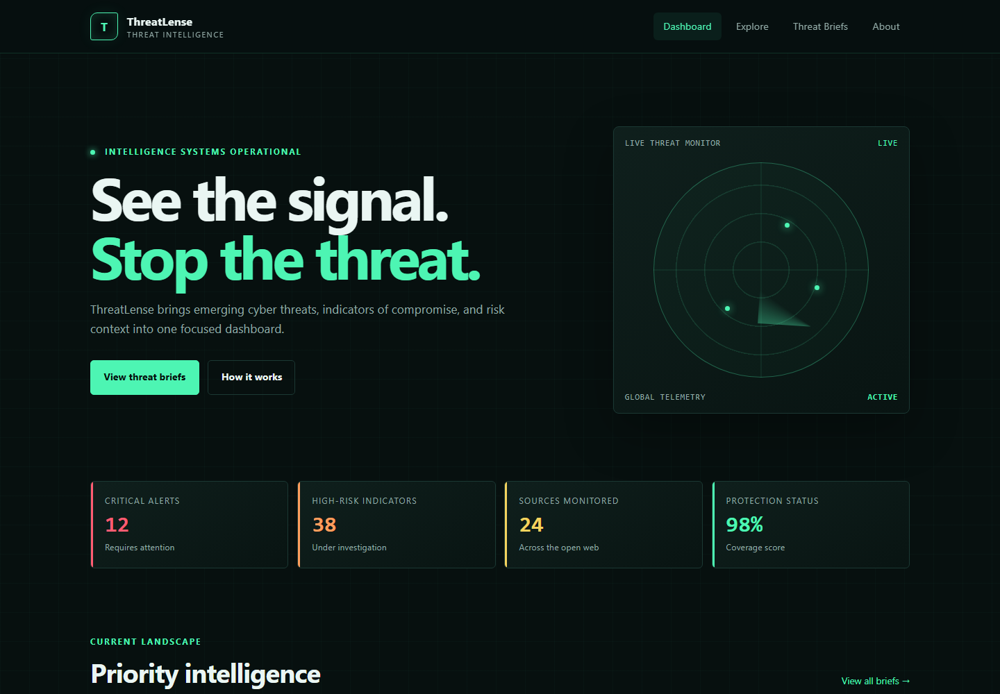
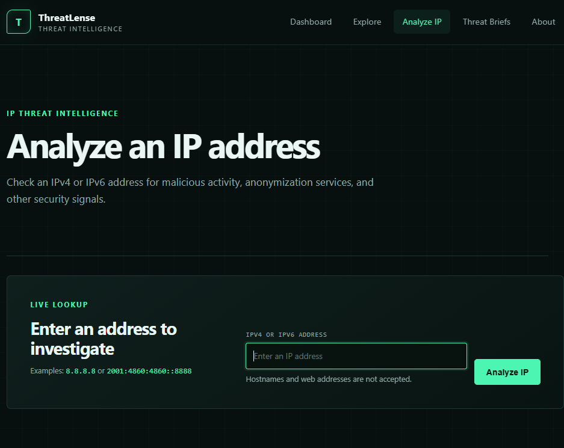
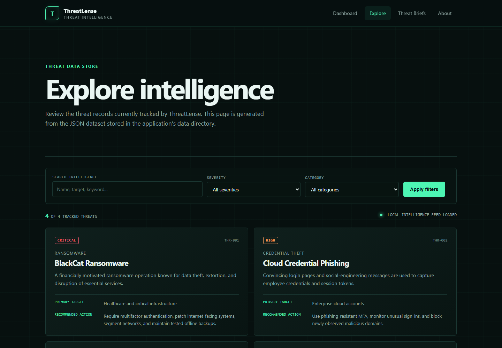
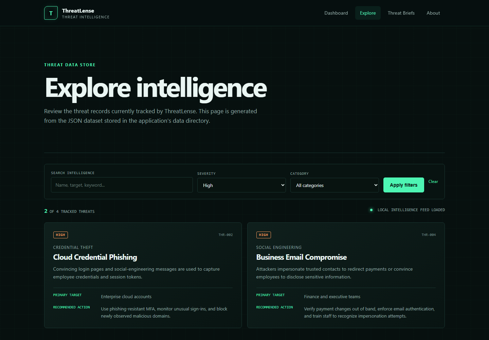
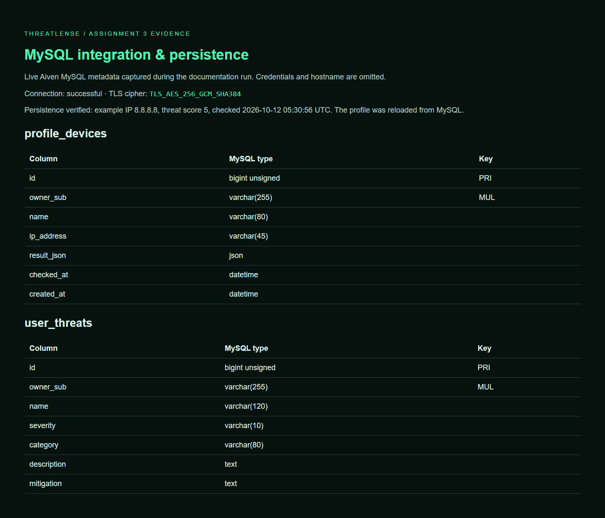
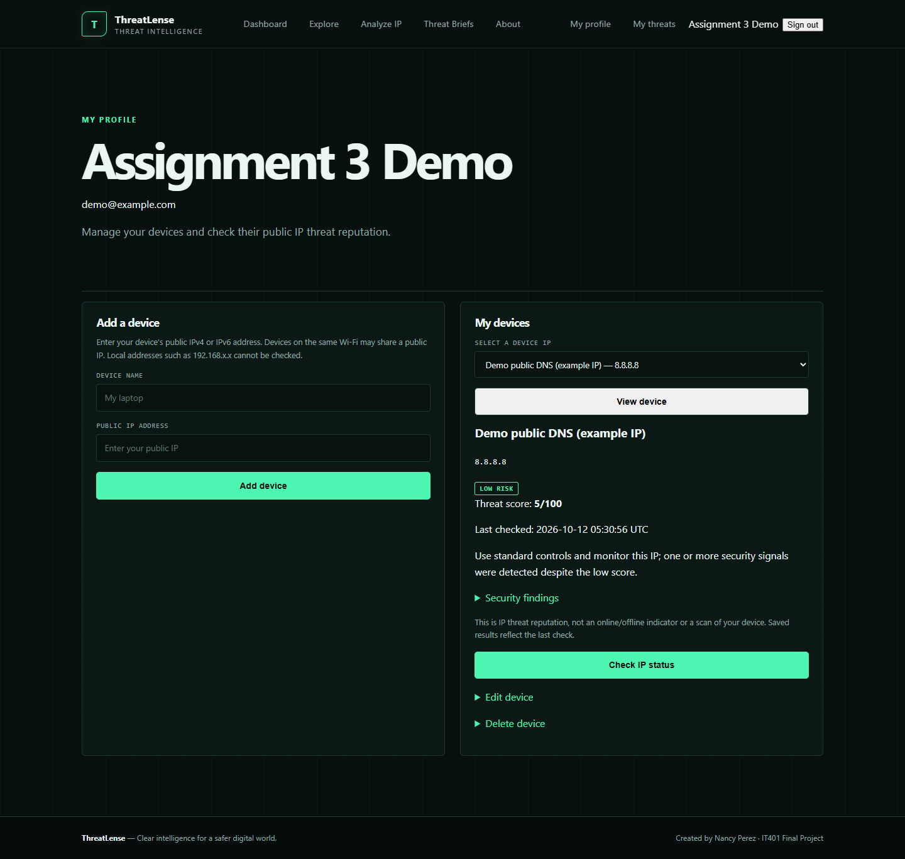
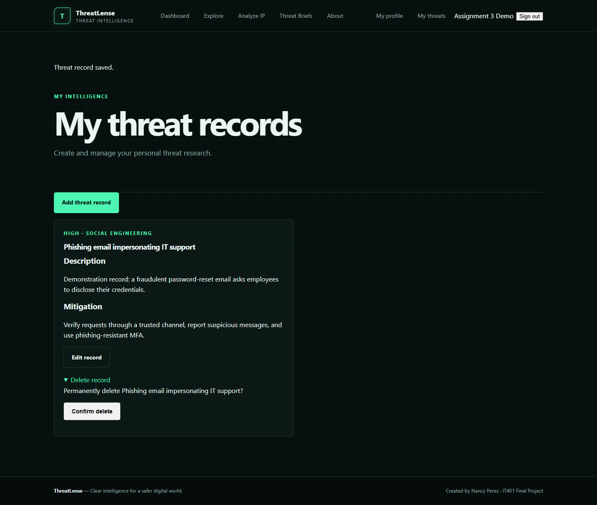
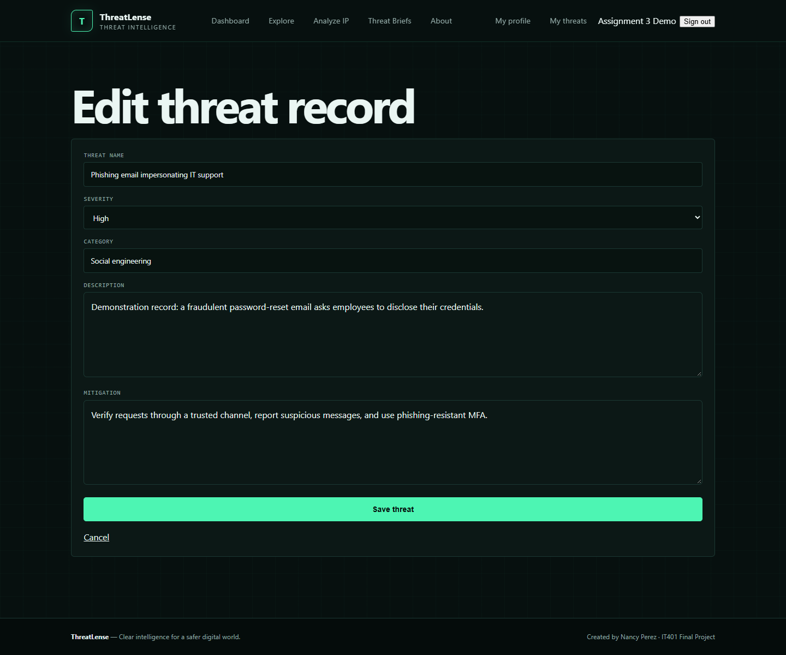
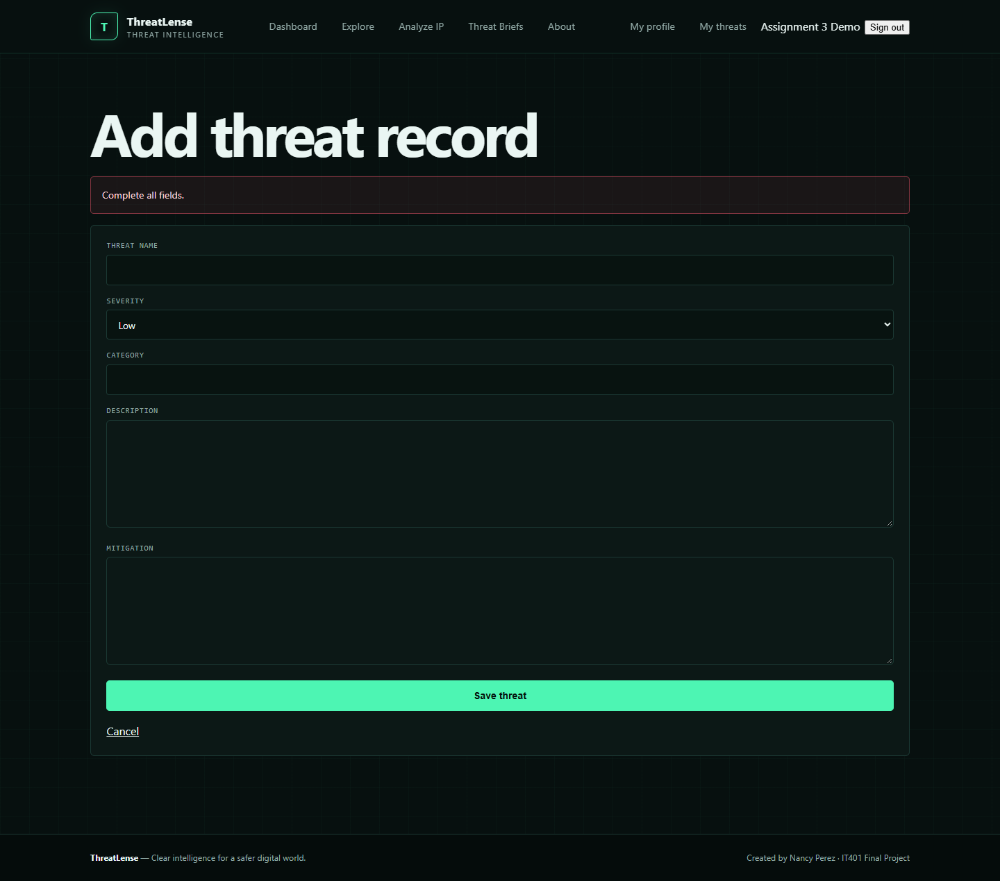
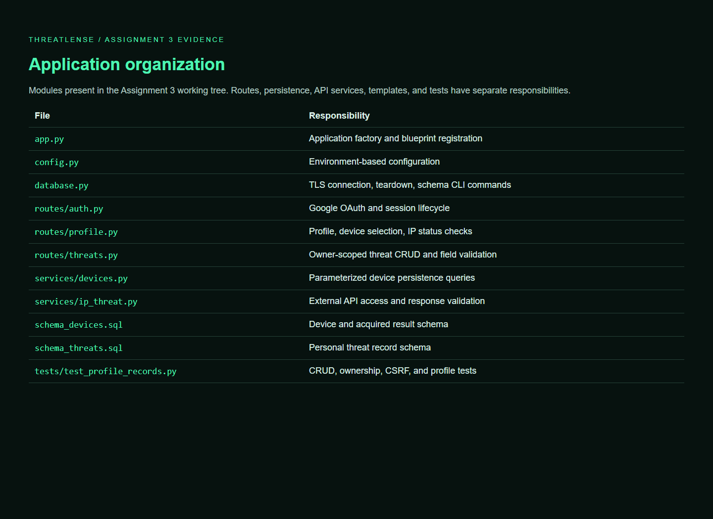

# ThreatLense

## Professor Walkthrough: Environment Setup

The application's `.env` file contains private API keys, Google OAuth credentials,
and Aiven MySQL connection settings. It is intentionally excluded from GitHub by
`.gitignore`, so cloning this repository will not download my local `.env` file.

1. Check out the submission branch: `git switch nancyperez-it401-a3`.
2. Open the project root, the folder containing `app.py`, `config.py`, and
   `.env.example`. On my computer this is
   `C:\Users\nnanc\OneDrive\Desktop\It401\nancyperez-it401-final-project`.
3. **If reviewing on my computer:** open `.env` in that folder using the VS Code
   Explorer. **If reviewing a cloned copy:** request the required credentials from
   me through an approved private course channel, or use your own service credentials.
   The README does not grant access to my local files or service accounts.
4. If I provide a `.env` file privately, save it in the project root. Otherwise,
   create one from the template with the PowerShell command below, then replace
   its placeholder values. Run this only if `.env` does not already exist:

   ```powershell
   Copy-Item .env.example .env
   ```

5. Supply `APIFREAKS_API_KEY`, `SECRET_KEY`, `GOOGLE_CLIENT_ID`,
   `GOOGLE_CLIENT_SECRET`, and the `MYSQL_*` settings listed in the template.
   Download the matching Aiven CA certificate and save it as `certs/ca.pem`, or set
   `MYSQL_SSL_CA` to its location. The certificate is also excluded from Git.
6. Follow the installation instructions below to create a virtual environment and
   install `requirements.txt`, then run:

   ```powershell
   python check_db.py
   python -m flask --app app:create_app init-devices
   python -m flask --app app:create_app init-threats
   python app.py
   ```

7. Open `http://127.0.0.1:5000`. For Google sign-in, the OAuth client must allow
   `http://127.0.0.1:5000/auth/google/callback`. If the Google app is in Testing,
   ask me to add your Google account as a test user when using my OAuth client.
   After signing in, open **My threats** to review CRUD operations and **My profile**
   to save a public IP and check its status.

Flask loads `.env` automatically at startup. Restart the server after changing it.
Please keep credentials out of commits, screenshots, and public course submissions.
Assignment 3 screenshots and requirement evidence are included near the end of this README.

- **Application:** ThreatLense
- **Student:** Nancy Perez
- **Course:** IT401
- **Assignment:** Semester Project

## Project Overview

ThreatLense is a Flask-based cybersecurity intelligence dashboard for students, junior analysts, and small organizations. It combines local demonstration threats with two external information sources so users can explore common threats, check the reputation of a public IP address, and review historical data breaches in one responsive interface.

ThreatLense is an educational project, not a replacement for a security operations platform or a definitive security advisory. Results should be verified with additional trusted sources before action is taken.

## External Information Sources

### API Freaks IP Threat Intelligence API

The IP Threat Checker acquires real-time external IP-security information from the [API Freaks IP Threat Intelligence API](https://apifreaks.com/api/ip-threat-intelligence). The server sends a validated public IPv4 or IPv6 address to the API and requests only the threat score, VPN, proxy, Tor, anonymity, known-attacker, bot, spam, and cloud-provider fields.

The API key is read from the `APIFREAKS_API_KEY` environment variable and sent in the server-side `X-apiKey` header. It is never placed in frontend code or an API query parameter.

### Wikipedia Data Breach List

The Data Breach Intelligence section acquires external public breach data by scraping the tables on Wikipedia's [List of data breaches](https://en.wikipedia.org/wiki/List_of_data_breaches). The application keeps only the organization or entity, year, records affected, organization type, and breach method. It removes citation markers and formatting, converts missing values to `Unknown`, removes empty and duplicate rows, and never displays raw HTML.

Successful scraped results are cached in memory for one hour. Scraping failures are cached for one minute to prevent repeated requests during a temporary outage.

## Application Workflow

1. A visitor opens the Flask dashboard.
2. Local demonstration threats are loaded from `data/threats.json` for the Explore page.
3. The dashboard requests the cleaned breach dataset from the scraper service. A recent cached copy is reused when available.
4. The user can search breach organizations or filter records by year and organization type. The initial table is limited to 15 records.
5. On the Analyze IP page, the user enters an IPv4 or IPv6 address.
6. The server validates that the input is a publicly routable address before making an external request.
7. The server calls API Freaks with the IP as the `ip` query parameter and the secret API key in the `X-apiKey` header.
8. ThreatLense validates the JSON response, calculates Low, Medium, or High Risk, and displays security findings and a short recommendation.

Risk classifications are:

| Threat score | Classification |
| --- | --- |
| 0–19 | Low Risk |
| 20–74 | Medium Risk |
| 75–100 | High Risk |

## Information Model

ThreatLense uses the following reference and acquired record types, plus the MySQL records described in the Assignment 3 section below.

### Local threat record

| Attribute | Description |
| --- | --- |
| `id` | Unique local threat identifier |
| `name` | Human-readable threat name |
| `category` | Threat category |
| `severity` | Critical, high, medium, or another supported level |
| `target` | Commonly affected industries, systems, or users |
| `description` | Summary of the behavior or risk |
| `mitigation` | Recommended defensive action |

### IP threat result

| Attribute | Description |
| --- | --- |
| `ip` | Validated public IPv4 or IPv6 address |
| `score` | API Freaks threat score from 0 to 100 |
| `risk_level` | Low Risk, Medium Risk, or High Risk |
| `findings` | Boolean VPN, proxy, Tor, anonymity, attacker, bot, spam, and cloud signals |
| `cloud_provider` | Cloud-provider name when available |
| `recommendation` | Short action based on the score and findings |

### Data breach record

| Attribute | Description |
| --- | --- |
| `entity` | Organization, agency, or other affected entity |
| `year` | Reported breach year |
| `records_affected` | Reported number or description of affected records |
| `organization_type` | Sector or organization classification |
| `breach_method` | Reported cause or method |

## Environment Variables

Create a `.env` file in the project root. A safe template is provided in `.env.example`.

```dotenv
APIFREAKS_API_KEY=your-api-key-here
```

| Variable | Required | Purpose |
| --- | --- | --- |
| `APIFREAKS_API_KEY` | Required for IP analysis | Authenticates server-side API Freaks requests |
| `SECRET_KEY` | Required for sign-in | Signs the Flask session; generate a random value |
| `GOOGLE_CLIENT_ID`, `GOOGLE_CLIENT_SECRET` | Required for sign-in | Google web OAuth client credentials |
| `MYSQL_HOST`, `MYSQL_PORT` | Required for saved records | Aiven MySQL hostname and assigned port |
| `MYSQL_USER`, `MYSQL_PASSWORD`, `MYSQL_DATABASE` | Required for saved records | Database credentials and database name |
| `MYSQL_SSL_CA` | Required for saved records | Path to the downloaded Aiven CA certificate |
| `FLASK_ENV` | Optional | Selects `development`, `production`, or the default configuration |
| `AI_SERVICE_API_KEY` | Not currently used | Reserved for a possible future AI service |

The `.env` file is ignored by Git. Never commit real keys, paste them into templates, or expose them in browser-side JavaScript.

## Installation Instructions

### Prerequisites

- Python 3.10 or newer
- Git
- An API Freaks account and key for the IP Threat Checker
- Internet access for API and Wikipedia requests

### 1. Clone the repository

```bash
git clone https://github.com/NPEREZ13/nancyperez-it401-final-project.git
cd nancyperez-it401-final-project
```

### 2. Create and activate a virtual environment

```bash
python -m venv .venv
```

Windows PowerShell:

```powershell
.venv\Scripts\Activate.ps1
```

macOS or Linux:

```bash
source .venv/bin/activate
```

### 3. Install dependencies

```bash
python -m pip install -r requirements.txt
```

### 4. Configure services

Copy `.env.example` to `.env` and replace the placeholders with your API Freaks, Google OAuth, and Aiven MySQL settings. Use the port shown in Aiven, which may differ from 3306. Download the Aiven CA certificate to `certs/ca.pem`; each developer supplies their own certificate and credentials.

Generate `SECRET_KEY` with `python -c "import secrets; print(secrets.token_hex(32))"`. In Google Auth Platform, register a Web application with the redirect URI `http://127.0.0.1:5000/auth/google/callback` and add your account as a test user. Authorized JavaScript origins can remain empty for this server-side flow.

Run `python check_db.py` to verify connectivity, then run the two initialization commands below before opening the profile or threat-record pages.

### 5. Run the application

```bash
python app.py
```

Open [http://127.0.0.1:5000](http://127.0.0.1:5000).

### Profiles and personal threat records

Sign in with Google, then use **My threats** to create, read, edit, and delete
personal threat records. Each account can access only its own saved records.
The Explore page continues to display the project's reference dataset.

Use **My profile** to add a named device with a public IPv4 or IPv6 address,
select a saved device, and click **Check IP status**. Results show the threat
score, findings, and last-check time in UTC. This measures public IP reputation,
not device health or online/offline status. Editing an IP clears its old result;
failed checks preserve the previous timestamped result. Lookups use the existing
`APIFREAKS_API_KEY` and may consume provider credits.

For a new database, configure the `MYSQL_*` environment variables and CA
certificate, then create the additional tables (existing tables are preserved):

```powershell
python -m flask --app app:create_app init-devices
python -m flask --app app:create_app init-threats
```

Google sign-in also requires `GOOGLE_CLIENT_ID`, `GOOGLE_CLIENT_SECRET`, and a
random `SECRET_KEY`. Restart Flask after configuration or code changes.

### 6. Run the tests

```bash
python -m pytest
```

## Current Features

- Responsive cybersecurity dashboard, navigation, and shared page layout
- Local JSON threat cards with keyword, severity, and category filtering
- Threat brief and About pages
- IPv4 and IPv6 input with public-address validation
- Server-side API Freaks integration using a protected request header
- Threat scoring, risk badges, security-signal cards, and recommendations
- Loading indicator and disabled Analyze IP button during requests
- Wikipedia breach-table scraping and cleanup into structured dictionaries
- Organization search plus year and organization-type breach filters
- Fifteen-record initial breach display with responsive table styling
- One-hour successful scrape cache and one-minute failure cache
- Automated route, API-client, parser, filtering, error, and caching tests

## Error Handling

The interface displays helpful messages instead of raw exceptions for:

- Empty, malformed, private, reserved, loopback, or link-local IP addresses
- Missing API configuration
- API authentication, authorization, credit, rate-limit, and server failures
- Network failures and request timeouts
- Empty API responses, invalid JSON, malformed fields, and out-of-range scores
- Wikipedia request and timeout failures
- Missing Wikipedia tables
- Changed tables with missing expected columns
- Valid tables that contain no usable breach records

External response bodies and secret values are not displayed to users. Both external requests use explicit timeouts.

## Ethical Considerations

- IP reputation is contextual and can change. A high score is an indicator, not proof that a person or organization is malicious.
- Shared networks, VPNs, proxies, Tor, and cloud infrastructure can produce legitimate traffic. Decisions should not rely on this tool alone.
- The IP checker performs a passive reputation lookup; it does not scan, probe, or attack the submitted address.
- Wikipedia data is public, attributed to its source, requested with an identifying user agent, and cached to reduce unnecessary traffic.
- Wikipedia is community-maintained and may contain incomplete, disputed, or outdated information.
- API keys and other credentials must remain private and must not be committed to source control.
- Breach information should be used for education and defensive awareness, not harassment or unauthorized activity.

## Known Limitations

- API Freaks requires a valid key, available account credits, and network access.
- Threat scores and security flags depend on the external provider's coverage and update schedule.
- Only publicly routable IP addresses are accepted; internal network addresses cannot be analyzed.
- Wikipedia's list is dynamic and non-exhaustive, and its table structure may change.
- The in-memory scrape cache resets whenever the Flask process restarts and is not shared across multiple server processes.
- Only the first 15 matching breach records are displayed; there is no pagination yet.
- Local threat records are demonstration data rather than live advisories.
- Aiven MySQL stores personal threat records, saved devices, and the latest successful IP analysis per device. It does not retain a full lookup history.
- Google identity details remain in the signed session; database rows are associated with the Google subject identifier.
- The standalone Analyze IP page does not persist results; use Check IP status on a saved profile device to persist a lookup.

## Screenshots

The repository currently includes these screenshot files:

### Homepage



## IP Page



### Explore Page



### Filtering Feature



Assignment 3 screenshots below show the new database-backed workflows. Older screenshots above document earlier assignment pages.

## Future Work

- Add pagination or incremental loading for the breach dataset
- Extend the latest saved device result into optional timestamped analysis history
- Add retrieval timestamps to the standalone IP and breach pages
- Add persistent caching suitable for multi-process production deployments
- Add more local threat records and detail pages
- Add charts for breach years, organization types, and methods
- Add screenshots for the IP Threat Checker and Data Breach Intelligence sections
- Expand integration and accessibility testing

## Project Structure

```text
threatlense/
|-- app.py
|-- database.py
|-- check_db.py
|-- schema_devices.sql
|-- schema_threats.sql
|-- config.py
|-- requirements.txt
|-- data/
|   `-- threats.json
|-- routes/
|   |-- auth.py
|   |-- profile.py
|   |-- threats.py
|   `-- main.py
|-- services/
|   |-- devices.py
|   |-- data_breaches.py
|   `-- ip_threat.py
|-- static/
|   |-- ip_checker.js
|   `-- style.css
|-- templates/
|   |-- profile.html
|   |-- threat_form.html
|   |-- threat_records.html
|   |-- analyze_ip.html
|   |-- base.html
|   |-- index.html
|   |-- explore.html
|   |-- menu.html
|   `-- about.html
|-- tests/
|   |-- test_auth.py
|   |-- test_profile_records.py
|   |-- test_app.py
|   |-- test_data_breaches.py
|   `-- test_ip_threat.py
`-- README.md
```


## Assignment 3: MySQL, CRUD, Organization, and Validation

Branch: `nancyperez-it401-a3`.

| Requirement | Implementation | Evidence |
| --- | --- | --- |
| Integrate MySQL | PyMySQL connects to Aiven with CA and hostname verification. Flask closes request connections automatically. Explicit CLI commands create tables without replacing existing data. | Database evidence screenshot; `database.py`, `schema_devices.sql`, `schema_threats.sql` |
| Persist acquired information | A successful profile IP lookup saves the validated API result as JSON with a UTC timestamp in `profile_devices`. A fresh request reloads it from MySQL. | Profile screenshot showing the saved IP result |
| Implement CRUD operations | Signed-in users create, read, update, and delete personal threat records through My threats. Device records also support CRUD. All queries are scoped by Google subject ID. | Threat list, edit, and delete screenshots |
| Improve application organization | App factory registers separate authentication, profile, and threat blueprints. Database lifecycle, device persistence, external API access, templates, schemas, and tests have separate files. | Organization evidence screenshot and project structure above |
| Validate incoming information | Server-side required-field and length checks, severity allowlist, public-IP normalization, CSRF protection, owner checks, parameterized SQL, and API response validation. | Validation screenshot and automated tests |

### Added behavior

- Google sign-in and POST logout, with OAuth state/ID-token validation and a verified-email requirement.
- My profile displays the signed-in identity and a selector for saved device IPs.
- My threats stores name, severity, category, description, and mitigation in `user_threats`.
- Editing a device IP clears its old status. Failed lookups retain the last successful result and its timestamp.
- Delete actions require an explicit confirmation button. Users cannot edit or delete another account's records.
- The public Explore dataset remains reference material; personal CRUD records appear under My threats.

### Validation and verification

Run `python -m pytest -q`. The suite covers OAuth errors, missing state, session behavior, CSRF, CRUD, ownership, required fields, private IP rejection, lookup failures, and existing API/scraper behavior. Read-only page checks were also run against Aiven. The screenshots use a separate demonstration identity; they do not show a real user's email or credentials. Screenshot records are removed after capture.

### MySQL integration

This evidence page displays schema metadata and connection verification queried from Aiven, rather than exposing the connection credentials.



### Persisted IP information and profile

The profile is reloaded after the lookup so the displayed result comes from the saved database row. IP reputation is not an online/offline check.



### Read and delete threat records



### Create and update threat records



### Incoming information validation

The screenshot shows a server-side rejection of an incomplete threat form.



### Application organization

This evidence view lists the implemented modules and their responsibilities.


