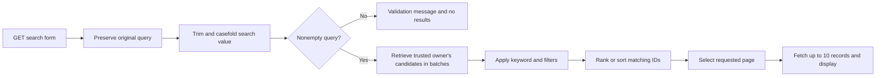
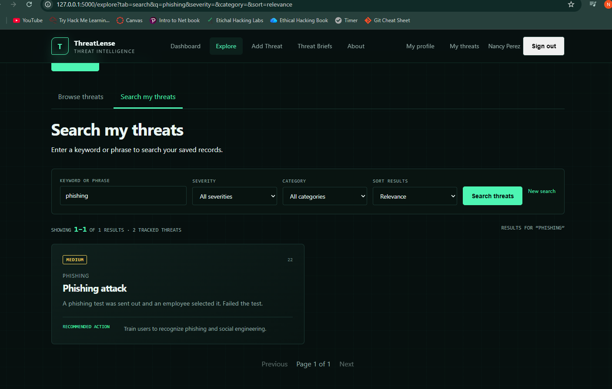
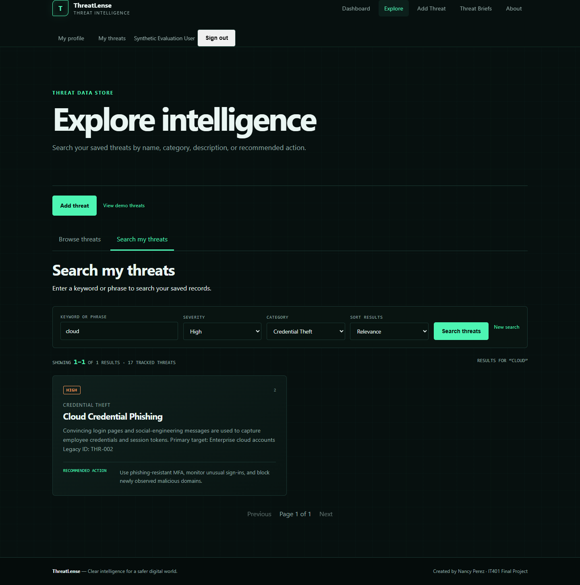
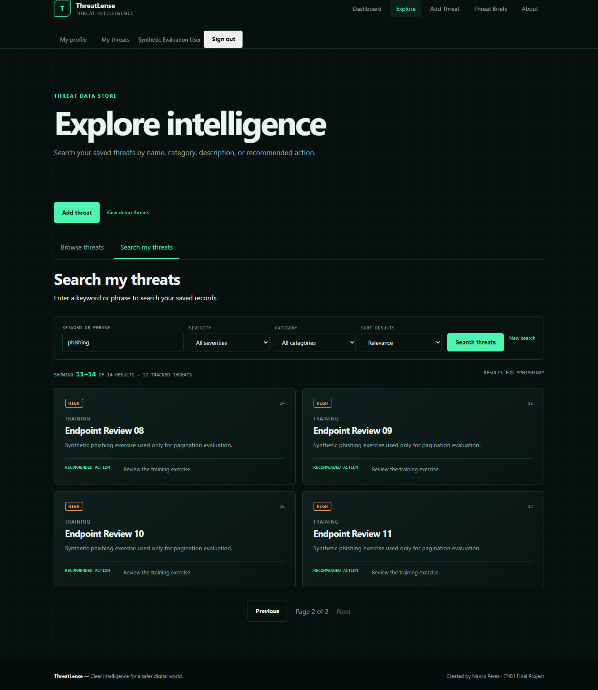
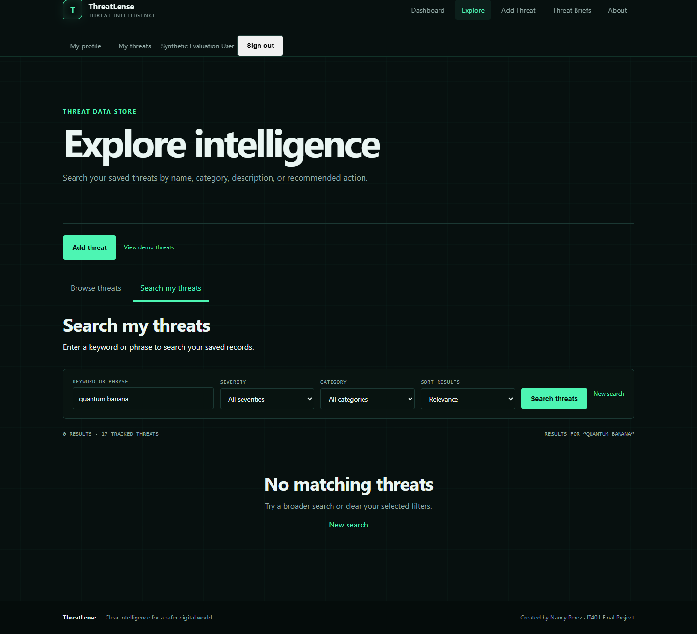
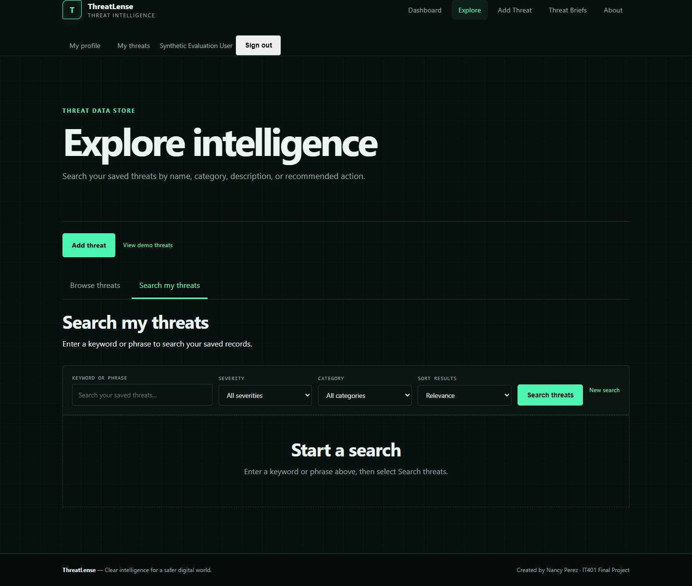
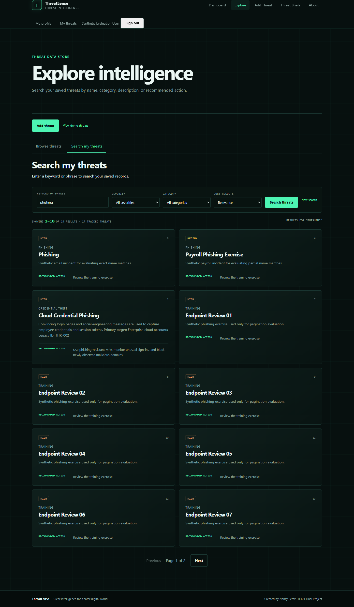
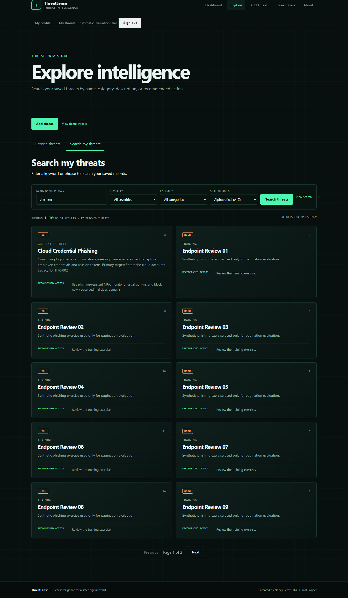

# ThreatLense

## Project Title

- **Application name:** ThreatLense
- **Student:** Nancy Perez
- **Course:** IT401
- **Assignment:** Semester Project - Assignment 4 (A4): Search and Retrieval

## Project Overview

ThreatLense is a Flask cybersecurity intelligence application for recording incidents, managing devices, and retrieving saved threat information. It serves cybersecurity students, junior analysts, and small organizations that need a clear view of a threat's severity, category, description, and mitigation.

Google accounts own their saved threats and devices in Aiven MySQL. Visitors can browse the original demonstration dataset; users can also start a private browser workspace before signing in. Search improves the application by finding relevant saved incidents and response guidance without manually reviewing every record. Filters, relevance ranking, alphabetical ordering, and pagination make results easier to review.

**Current implementation status:** keyword retrieval is implemented. Search telemetry and the A3 web scraper are **not implemented in this A4 working tree**. They are documented as gaps and future work below, rather than presented as completed functionality. The dashboard's counters and live-monitor graphics are demonstration content, not measured live telemetry. Example threats are not live security advisories.

## Search and Retrieval Features

| Feature | Current behavior |
| --- | --- |
| Interface | Explore has Browse threats and Search my threats tabs. |
| Keyword search | An HTML GET form accepts a keyword or contiguous phrase; the original query remains in the URL and input. |
| Query processing | A separate search value uses `strip()` and Unicode `casefold()`; blank submissions show a message and no results. |
| Fields searched | Numeric record ID, name, category, description, and mitigation. |
| Filters | Severity and category; both combine with the keyword using AND. |
| Sorting | Relevance (default) or Alphabetical (A-Z). |
| Ranking | Weighted name/category/description/mitigation/ID matches; exact names precede partial names. |
| Pagination | 10 results per page, Previous/Next links, result range, and page count. |
| State preservation | Page links preserve the original query, filters, sort, and selected collection. New search clears the search state. |
| Private retrieval | Searches include only the current Google account or browser workspace's records. |
| Search telemetry | Not implemented: no application search-history table, event recorder, click tracking, or history screen. |

Open `/explore?tab=search`, enter a query, and select **Search threats**. Search does not require source-code edits. Anonymous search never exposes other users' records or silently searches the public collection.

## Search Workflow



The retrieval sequence is **Retrieve -> Filter -> Rank -> Paginate -> Display**. The route receives the request and constructs links; the search service coordinates retrieval; templates display the form and results.

## Searchable Information

The searchable model is `UserThreat`, persisted in `user_threats`. `ProfileDevice` is persisted and managed through My Profile but is not part of threat keyword search.

| Field | Searchable | Filter | Ranking contribution | Reason |
| --- | --- | --- | --- | --- |
| `id` | Yes, substring of numeric ID | No | +1 | Allows a known saved record to be found. |
| `name` | Yes | No | Exact normalized match: 100; otherwise partial name: 50 | Incident names are the strongest relevance signal. |
| `category` | Yes | Exact value, case-insensitive | +10 | Supports threat-type discovery and narrowing. |
| `severity` | No | Exact value, case-insensitive | None | Severity narrows risk level without making severe records automatically more relevant. |
| `description` | Yes | No | +5 | Captures incident details, affected targets, and context. |
| `mitigation` | Yes | No | +2 | Finds saved response and prevention guidance. |
| `owner_sub` | No | Mandatory internal scope | None | Enforces data separation; never accepts a request-supplied owner. |

The legacy JSON `target` and string ID have no separate columns. The explicit import preserves them in the description as `Primary target: ...` and `Legacy ID: ...`, making that information searchable without changing the tables.

## Retrieval Strategy

Matching is a literal, case-insensitive **substring search in Python**, not SQL LIKE, ILIKE, MySQL full-text search, embeddings, or semantic search. The complete normalized phrase must occur within at least one searched field; terms are not split into independent AND/OR tokens. SQLAlchemy retrieves owner-scoped candidates using bound parameters. Raw query text is never interpolated into SQL, and Jinja escapes the original query when displaying it.

Severity and category filters use case-insensitive equality. When both are supplied, a result must satisfy the keyword **and** severity **and** category. Unknown filter values produce no matching records; they are not automatically corrected to a supported value.

Relevance uses the field weights above. Exact and partial name scores are mutually exclusive; contributions from other fields are added. The highest possible non-name score is 18, so name matches always precede matches only in other fields. Ties sort by case-folded name, then ID. Alphabetical ordering uses case-folded name, then ID. Invalid sort values fall back to relevance. Browse retains ascending ID order.

The service reads candidates in keyset batches of at most 100 rows, retaining compact ranking keys and IDs instead of all complete records. It ranks all matches before selecting the page, then fetches at most 10 full records for display. Previous/Next links retain query and filter state. Invalid or negative page numbers become page 1; numbers beyond the last page use the last page. New submissions start on page 1.

**Scaling limitation:** every search/page request still scans the current owner's candidates to perform Unicode matching and custom ranking. Batching bounds full-record memory, but the matching-ID list grows with the result count and sorting takes O(m log m) for m matches. This is not database-side full-text or indexed keyword retrieval. Concurrent record changes can affect results between page requests; pages are not a permanent snapshot.

## Search Telemetry

**Current behavior:** the application does not persist search activity, durations, result clicks, zero-result searches, or per-user history. The model metadata contains only `user_threats` and `profile_devices`. The dashboard's "Global telemetry" label is a visual demonstration and does not indicate search instrumentation.

GET queries can appear in browser history and development HTTP access logs because they are part of the URL. These are not a structured application search-history system. Do not enter credentials or other secrets into a search query.

[docs/search-evaluation.json](docs/search-evaluation.json) records deliberately executed offline evaluation queries and outcomes. It is **evaluation evidence, not production search telemetry**. No telemetry-failure recovery path is implemented because there is no recorder.

A future telemetry implementation could record a trusted owner subject, submitted/normalized query, selected filters/sort/page, result count, duration, and UTC timestamp. Those events could identify common terms, zero-result patterns, slow searches, and opportunities for suggestions or recommendations. A later design should define consent, access controls, retention/deletion, and sensitive-query handling. Recording should fail independently without preventing results from displaying; that behavior still needs implementation and tests.

## Database Schema

Flask-SQLAlchemy maps the two existing Aiven tables. Application startup does not create, drop, or alter them. [docs/schema.sql](docs/schema.sql) is a reference/bootstrap schema for a **new development database**, using `CREATE TABLE IF NOT EXISTS`; it does not migrate an existing mismatched schema.

| Table / model | Purpose | Primary key | Important attributes | Relationships |
| --- | --- | --- | --- | --- |
| `user_threats` / `UserThreat` | Account/workspace-owned saved incidents | `id`, BIGINT UNSIGNED AUTO_INCREMENT | `owner_sub` ASCII VARCHAR(255); `name` VARCHAR(120); `severity` VARCHAR(10); `category` VARCHAR(80); `description` TEXT; `mitigation` TEXT | Logical ownership by Google subject or browser-workspace key; index `idx_threats_owner`. |
| `profile_devices` / `ProfileDevice` | Saved devices and latest IP reputation check | `id`, BIGINT UNSIGNED AUTO_INCREMENT | `owner_sub` ASCII VARCHAR(255); `name` VARCHAR(80); `ip_address` VARCHAR(45); nullable `result_json` JSON and `checked_at` DATETIME; server-generated `created_at` DATETIME | Same logical ownership; index `idx_devices_owner`. |

Ownership columns use case-sensitive `ascii_bin`. There is no persisted User table or foreign key between these tables; the owner subject is the application-level relationship. API datetimes use ISO strings. Checked timestamps with offsets are converted to UTC before storage; naive values are treated as UTC.

### Proposed telemetry schema - not applied

No new search-history or telemetry table exists, and there is no telemetry migration to run. The following is a **future design**, not a claim about the live database:

| Proposed table | Purpose | Primary key | Proposed attributes | Relationships |
| --- | --- | --- | --- | --- |
| `search_history` | Record completed searches for evaluation and later recommendations | `id`, BIGINT UNSIGNED | `owner_sub`, `query_text`, `normalized_query`, `filters_json`, `sort_order`, `page_number`, `result_count`, `duration_ms`, `created_at` (UTC) | Owner-scoped logical relationship to the same account/workspace; index owner and timestamp. No click/record relationship is implemented. |

A versioned additive migration, SQLAlchemy model, recorder, failure handling, and owner-scoped history interface are required before this proposed table can be described as an A4 feature.

## Current Features

| Feature through A4 | Status and implementation |
| --- | --- |
| Homepage | Responsive dashboard with demonstration metrics and threat cards; shared navigation/footer. |
| Google profile | Google OpenID Connect sign-in, verified-email check, My Profile, and CSRF-protected sign-out. |
| API integration | API Freaks public-IP reputation lookup from a saved profile device; saved findings and check timestamp. Uses a 10-second timeout and safe provider errors. |
| Web scraping | Not present in this A4 working tree. A3 contains a breach-scraper implementation; restoration/integration remains outstanding. JSON import is not web scraping. |
| MySQL persistence | Flask-SQLAlchemy/PyMySQL maps existing Aiven tables with CA and hostname verification. |
| CRUD operations | Account threat create/edit/delete, device CRUD, and owner-scoped JSON APIs. |
| Threat entry | Name, category, and mitigation choices with Other fields; severity and incident description. |
| Duplicate prevention | Identical creates for the same owner reuse the existing threat; MySQL advisory locks cover concurrent threat creates; Save disables while submitting. |
| Keyword search | Dedicated GET Search tab, retained original query, processed literal matching. |
| Filtering | Severity and category combined with keyword matching. |
| Sorting and ranking | Weighted relevance or alphabetical ordering, deterministic ties. |
| Pagination | 10 records/page, ranges, Previous/Next navigation, preserved search state. |
| Search telemetry | Not implemented; proposed schema and intended uses documented separately. |
| Data validation | Required fields, type/length checks, allowed severities, IPv4/IPv6 validation, JSON/date validation, CSRF and owner scoping. |
| Other pages | Threat Briefs and About; public demo collection imported from the original JSON. |

### Identity, browser workspaces, and persistence

Google's stable subject owns account records; email is not used as an ownership key. OAuth tokens are not saved in the signed cookie. Another account's record ID returns 404. Anonymous Browse shows only the reserved public-demo collection; private Search never substitutes that collection.

Before login, Add Threat can create a private browser workspace derived from a server-issued form token. Keep the same browser cookies to retain access. Google sign-in preserves that workspace, and My Profile offers **Move workspace records to my account**. It changes ownership only for the workspace proven by the signed session. Sign out clears the session, so move desired workspace records before signing out. Workspace records are not automatically merged into an unrelated account.

Changing a profile device's IP clears its saved check. An in-flight check is saved only if the device still has the checked IP. IP reputation is not a device availability check or a vulnerability scan.

## Project Structure

```text
nancyperez-it401-final-project/
|-- app.py                         # Factory, configuration, registration, safe DB errors
|-- config.py                      # Existing MYSQL_ variables and verified TLS
|-- requirements.txt
|-- .env.example                   # Names/placeholders only; actual .env is ignored
|-- models/
|   `-- __init__.py                 # db, UserThreat, ProfileDevice
|-- routes/
|   |-- main.py                    # General pages and Add Threat form
|   |-- search.py                  # Explore GET requests, page URLs, rendering
|   |-- auth.py                    # Google sign-in/callback/logout
|   |-- profile.py                 # Profile/device forms and workspace transfer
|   |-- threats.py                 # Google-account threat management
|   `-- records.py                 # JSON threat/device CRUD API
|-- services/
|   |-- search_service.py          # Processing, retrieval, filters, ranking, pagination
|   |-- records.py                 # Trusted ownership and input validation
|   |-- threat_storage.py          # Duplicate-safe threat creation
|   |-- devices.py                 # Device persistence and saved checks
|   |-- ip_threat.py               # API Freaks acquisition/response validation
|   |-- migration.py               # Explicit, duplicate-safe legacy JSON import
|   |-- categories.py              # Category form choices
|   |-- threat_names.py            # Threat-name form choices
|   |-- mitigation.py              # Mitigation form choices
|   |-- api_service.py             # General HTTP wrapper
|   `-- ai_service.py              # Unimplemented AI placeholder
|-- templates/
|   |-- base.html                  # Navigation, Google account links, shared layout
|   |-- explore.html               # Browse/Search page shell and tabs
|   |-- search.html                # GET form, filters, sort, validation
|   |-- results.html               # Cards, empty states, ranges, pagination
|   |-- add_threat.html             # Browser/account threat entry
|   |-- threat_form.html           # Account create/edit form
|   |-- threat_records.html        # Account threat list
|   |-- profile.html               # Saved devices and IP checks
|   |-- _category_field.html       # Shared category selector
|   |-- _threat_name_field.html    # Shared name selector
|   |-- _mitigation_field.html     # Shared response selector
|   `-- index.html, menu.html, about.html
|-- static/
|   |-- style.css                  # Responsive interface
|   `-- mitigation.js              # Other fields and duplicate-submit UI protection
|-- data/threats.json               # Original demo data; retained unchanged
|-- certs/ca.pem                    # Supply your Aiven CA certificate locally
|-- docs/
|   |-- schema.sql                 # Existing-table reference/bootstrap DDL
|   |-- evaluate_search.py         # Isolated evaluation and screenshot utility
|   |-- search-evaluation.json     # Five measured query outcomes; not telemetry
|   `-- screenshots/               # Current A4 evidence and historical images
|-- tests/                          # Routes, search, ranking, pages, CRUD, auth, API tests
|-- instance/                       # Ignored local runtime/backup artifacts
`-- README.md
```

The route layer does not implement the ranking algorithm or read SQL results itself. The search service accepts a parameter mapping and trusted owner, independently of Flask request/session globals. Data acquisition is separated from interactive search; templates separate the interface from result rendering.

## Installation Instructions

### 1. Clone and select the A4 branch

```powershell
git clone https://github.com/NPEREZ13/nancyperez-it401-final-project.git
cd nancyperez-it401-final-project
git switch nancyperez-it401-a4
```

The local A4 changes must be committed and pushed before another clone contains them.

### 2. Create and activate a virtual environment

Use Python 3.10 or newer:

```powershell
python -m venv .venv
.\.venv\Scripts\Activate.ps1
```

On macOS/Linux, activate with `source .venv/bin/activate` instead.

### 3. Install dependencies

```powershell
python -m pip install -r requirements.txt
```

### 4. Configure .env and the CA certificate

If `.env` already exists, retain its values. Otherwise:

```powershell
Copy-Item .env.example .env
```

Fill in the variables below, supply a strong random `SECRET_KEY`, and save the Aiven CA certificate at `certs/ca.pem` or the configured path. Relative certificate paths resolve from the project root. Do not commit `.env` or include credential values in screenshots or commands shared with others.

For Google sign-in, the OAuth web client must allow `http://127.0.0.1:5000/auth/google/callback`. Browsing through `localhost` requires the matching callback hostname in Google's configuration. If the OAuth application is in Testing, add the intended Google account as a test user. Production requires the corresponding HTTPS callback.

### 5. Apply database setup or migrations as appropriate

**Existing Aiven database:** both tables already exist. No new DDL migration is shipped or required for these search changes. Do not drop/recreate those tables or run `db.create_all()`/`db.drop_all()` against them. There is no `flask db upgrade` command because Flask-Migrate is not installed.

**New, empty development database:** connect with a MySQL client using verified TLS, select the intended database, and apply [docs/schema.sql](docs/schema.sql). The script creates only missing tables and does not repair mismatched existing definitions. Compare an existing schema before any separately planned migration. The proposed telemetry table is not included or installed.

Optionally preview/import original demo threats for public Browse:

```powershell
python -m flask --app app:create_app import-json --public-demo
python -m flask --app app:create_app import-json --public-demo --apply
```

Private import uses `--owner-sub "verified-user-subject"` instead of `--public-demo`; `--file path/to/threats.json` selects another source. Preview rolls back; `--apply` commits. Exact unchanged records for the same owner are skipped, imports are serialized per owner, and failures roll back. Source JSON and existing records are not overwritten or deleted. Files containing unexpected ownership fields are rejected rather than silently published. No device JSON exists to import.

### 6. Run the application

```powershell
python app.py
```

Open [ThreatLense](http://127.0.0.1:5000). Sign in with Google, add threats through **Add Threat** or **My threats**, then use **Explore -> Search my threats**. For production, use HTTPS, a production WSGI server, and `FLASK_ENV=production` to disable debug and enable secure session cookies.

### 7. Run verification

```powershell
python -m pytest -q
python docs/evaluate_search.py
```

The local suite uses isolated in-memory SQLite; MySQL tests are skipped unless explicitly enabled. At this documentation update, **112 local tests passed and 7 live tests were skipped**. Live Aiven checks were executed during implementation separately; they are not equivalent to completing Google's interactive login with a real account.

To opt into the live suite:

```powershell
$env:RUN_MYSQL_INTEGRATION = '1'
try {
    python -m pytest tests/test_mysql_integration.py -q
} finally {
    Remove-Item Env:RUN_MYSQL_INTEGRATION
}
```

Live tests insert only UUID-owned synthetic records and clean up their own rows. They perform no table DDL. Interrupting a live test can leave synthetic rows, and AUTO_INCREMENT counters may advance even after rollback/deletion.

## Environment Variables

Use the existing variable names; no actual credentials are included here or in `.env.example`.

| Variable | Requirement | Purpose |
| --- | --- | --- |
| `SECRET_KEY` | Required | Sign sessions and protect form state; use a strong random value. |
| `MYSQL_HOST` | Required | Aiven MySQL hostname. |
| `MYSQL_PORT` | Required | Assigned Aiven port; use its actual configured value. |
| `MYSQL_USER` | Required | Database account. |
| `MYSQL_PASSWORD` | Required | Database password. |
| `MYSQL_DATABASE` | Required | Existing database name. |
| `MYSQL_SSL_CA` | Required | CA file path; certificate chain and hostname verification remain enabled. |
| `GOOGLE_CLIENT_ID` | Required for Google login | Existing OAuth web client ID. |
| `GOOGLE_CLIENT_SECRET` | Required for Google login | Existing OAuth web client secret. |
| `APIFREAKS_API_KEY` | Required for profile IP checks | Server-side API Freaks credential, sent in a header. |
| `FLASK_ENV` | Optional | `development`/default or `production`. |
| `RUN_MYSQL_INTEGRATION` | Tests only, optional | `1` explicitly enables live database tests. |

`API_KEY` and `AI_SERVICE_API_KEY` remain legacy configuration placeholders; they do not activate an implemented AI or search feature. No RAPIDAPI_KEY or DB_USERNAME aliases replace the actual MYSQL_ settings.

## Error Handling

| Situation | Current behavior |
| --- | --- |
| Empty query | Initial form shows a prompt. Submitted empty/whitespace query shows a clear message, returns no results, and preserves the original input. |
| Invalid filters | Nonmatching severity/category values return no records; no SQL is constructed from them. The UI normally offers values present in the owner's data. |
| Invalid sort/tab | Unknown sort becomes relevance; unknown tab becomes Browse. |
| Invalid page number | Noninteger/negative/zero becomes 1; too-large values clamp to the final page. |
| No results | Explicit no-results state with New search; no empty pagination navigation. |
| Database errors | SQLAlchemy errors roll back; users receive a generic 503. Logs record the exception class rather than SQL parameters or credentials. |
| Invalid CRUD input | Required/type/length/severity/IP/JSON/datetime validation rejects bad data. JSON API errors use 400, non-JSON writes use 415, oversized requests use 413. |
| Ownership/CSRF | No identity gives API 401; another owner's record gives 404; missing/invalid form CSRF gives 400. |
| Provider errors | API timeouts, bad keys, exhausted credits, rate limits, and malformed responses produce safe messages. Previous saved device results remain after a failed check. |
| Google login errors | Missing configuration, rejected/unverified identity, OAuth state, and token-validation errors show a message without saving OAuth tokens. |
| Telemetry failures | No recorder exists, so no telemetry-specific failure handling currently exists. A future recorder must fail independently of search. |

## Search Evaluation

Evaluation date: **October 25, 2026**. [Reproducible utility](docs/evaluate_search.py) and [complete measured output](docs/search-evaluation.json).

The fixture contains 17 threats in an isolated SQLite database: four imported original demonstration records plus 13 clearly synthetic records for ranking and pagination. A simulated account owns them. It does not connect to Aiven, consume API credits, or use a real Google account. Expected relevance labels are declared before retrieval in the utility; the MFA case intentionally uses semantic relevance to expose an acronym gap.

Precision = relevant retrieved / all retrieved. Recall = relevant retrieved / expected relevant. Scores below use all matching pages, not only the first 10 results. Empty-set measures are reported as N/A rather than misleadingly claiming 100%.

| Query and filters | Expected results | Actual results | Precision | Recall | Ranking observations |
| --- | --- | --- | --- | --- | --- |
| `  PHISHING  `; relevance | Exact/partial-name phishing records plus 11 description matches: 14 total | All 14, across pages of 10 and 4 | 100% | 100% | Phishing: 110; Payroll Phishing Exercise: 60; Cloud Credential Phishing: 52; description-only records: 5 each. |
| `cloud`; severity High, category Credential Theft | Cloud Credential Phishing | Cloud Credential Phishing | 100% | 100% | Combined filters retain the intended record, score 55. |
| `MFA`; relevance | BlackCat Ransomware and Cloud Credential Phishing both describe MFA-related mitigation | Cloud Credential Phishing only | 100% | 50% | The literal acronym scores 2; expanded "multifactor authentication" is missed. |
| `BlackCat Ransomware`; relevance | Exact named threat | BlackCat Ransomware | 100% | 100% | Exact title scores 100. |
| `quantum banana`; relevance | No records | No records | N/A | N/A | Correct explicit no-results state. |

These small, deliberately constructed examples verify behavior, not general retrieval accuracy. Four returning-query precisions are 100%, but the acronym query demonstrates a real recall limitation. Ranking prioritizes exact names as intended; equally scored description matches receive alphabetical/ID ties, not semantic discrimination. Planned improvements include acronym/synonym normalization, a larger independently labeled evaluation set, multi-term matching, and full-text/semantic comparison.

## Screenshots

### Signed-in search in the running application

The screenshot below was supplied by Nancy from the running application. It shows a signed-in search for `phishing`, the query preserved in the browser URL and search field, the Relevance selection, and one matching saved threat. My Profile, My Threats, and Sign out are visible in the navigation.



### Filtered results

This complementary example narrows `cloud` to High severity and Credential Theft, leaving the matching threat visible while retaining the selections in the form.



### Pagination

This example shows results 11-14 of 14 on page 2, with Previous navigation and Next disabled on the last page.



### No-results state

An unmatched query produces a clear message and a New search link so the user can try again.



**Evaluation screenshot context:** all images except Nancy's supplied signed-in screenshot are real browser captures of the isolated evaluation application. That simulated account is labeled Synthetic Evaluation User. These additional captures demonstrate the interface using demo/synthetic data, not real Google authentication or live MySQL telemetry.

### Additional search evidence

<details>
<summary>Search form</summary>



</details>

<details>
<summary>Search results and relevance ranking</summary>



</details>

<details>
<summary>Alphabetically sorted results</summary>



</details>

**Search-history/telemetry evidence:** no history screen or telemetry table exists to capture. The [evaluation artifact](docs/search-evaluation.json) explicitly records `search_telemetry_implemented: false` and lists the two model tables. This is a documented missing requirement, not a substitute claim that telemetry was implemented.

Historical screenshots remain available: [homepage](docs/screenshots/homepage.png), [earlier Explore](docs/screenshots/explore.png), and [earlier filtering](docs/screenshots/filter.png). They predate the current A4 Search tab.

To regenerate the evaluation screenshots (Nancy's supplied screenshot remains unchanged), optionally install the capture dependency and use an installed Edge browser:

```powershell
python -m pip install playwright
python docs/evaluate_search.py --screenshots
```

Playwright is optional documentation tooling, not an application dependency. The utility starts and stops an isolated loopback preview server and does not replace the running application.

## Design Decisions

- Search incident names for focused discovery, descriptions for context, and mitigations for response guidance. Include categories and IDs for type/known-record lookup.
- Use severity and category as filters because they are understandable structured fields. Keep severity out of relevance scoring so urgency and query relevance remain distinct.
- Use transparent field weights: exact names outrank partial names, which outrank context-only matches. Stable name/ID ties make pagination repeatable for an unchanged dataset.
- Display 10 records per page to limit visual load and rendered HTML. Batched retrieval preserves Python Unicode behavior, while acknowledging the remaining scan/ranking cost.
- Scope by the trusted session before matching. Public examples and private records are separate collections.
- Preserve original query text for user confirmation while processing a separate search value. Use bound SQLAlchemy parameters and HTML escaping.
- Keep ingestion, HTTP handling, search processing, persistence, and templates in separate modules.
- Future telemetry should support measured improvements to zero-result handling and later recommendations. Its absence currently prevents learning from real usage; any later implementation needs privacy and retention controls.

## Known Limitations

- Literal substring matching does not understand synonyms, paraphrases, acronyms, or intent; the MFA evaluation demonstrates this.
- No stemming/lemmatization; some singular/plural forms may return different results.
- Multiword input is one contiguous phrase; no Boolean operators or independent token matching.
- Ranking is rule-based, not learned or personalized; no timestamps exist on threats for newest/oldest ordering.
- Search has no full-text index, and every page request scans the owner's candidates. Compact ranking keys still grow with the match set.
- Profiles/devices and externally acquired IP results are not keyword-searchable threat records.
- Unknown filters yield no results rather than dedicated field validation errors.
- GET queries remain visible in URLs and may be present in browser/access logs.
- Search telemetry/history and the A3 breach scraper are absent from this A4 working tree.
- Demo dashboard metrics are static; the AI service is a placeholder.
- Browser workspace access depends on cookies; transfer to Google before signing out if those records need account access.

## Future Work

For A5 or later modules:

1. Implement owner-scoped search telemetry/history with an additive migration, retention controls, nonblocking failure handling, and tests.
2. Restore and validate the A3 breach scraper as an independent acquisition service; track source and freshness.
3. Add acronym/synonym expansion (for example MFA and multifactor authentication), query suggestions, and autocomplete.
4. Compare MySQL full-text retrieval with the current baseline on a larger labeled dataset; push eligible filters/ranking/pagination into indexed retrieval.
5. Evaluate embeddings and semantic search for paraphrases and response guidance.
6. Explore consent-based personalized ranking and recommendations once telemetry is available and evaluated.
7. Add source-backed retrieval-augmented generation with citations and checks against unsupported answers.
8. Improve incident dates, detail pages, acquisition history, and repeatable precision/recall/ranking evaluation.
